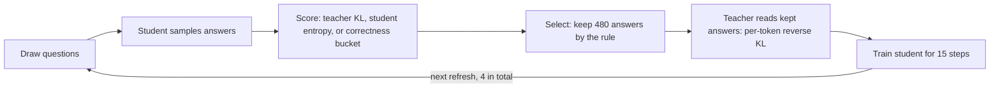
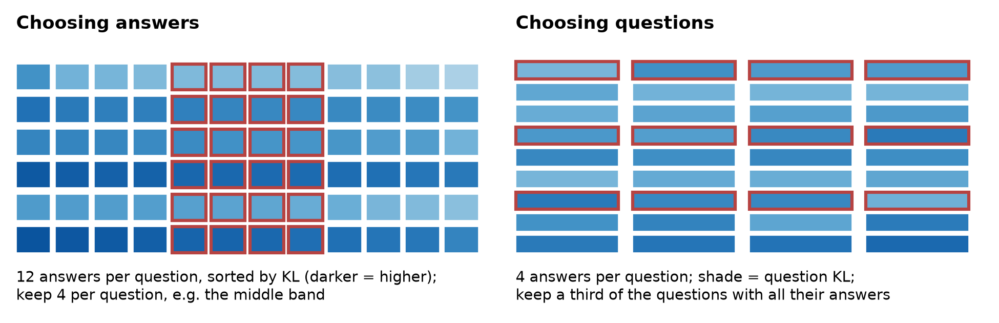
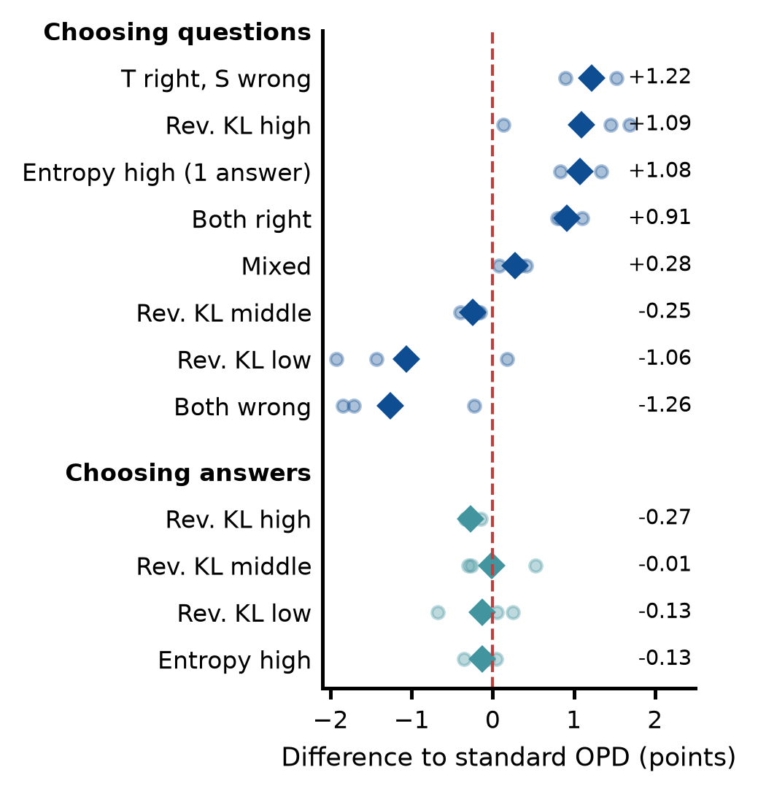
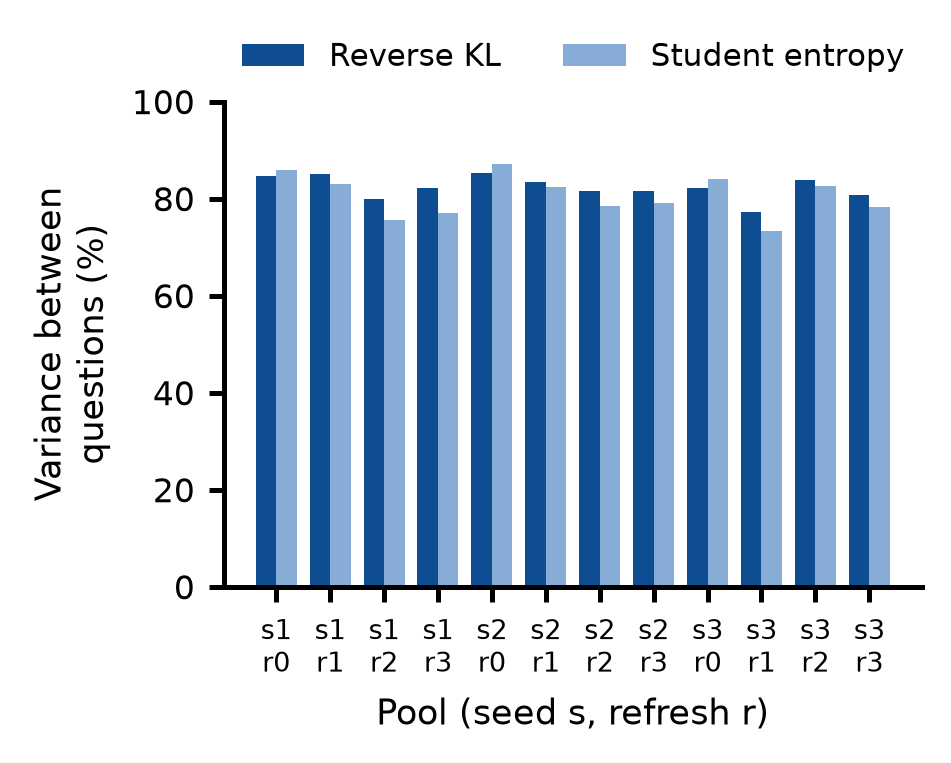

<!-- SUPERSEDED 2026-11-19 by papers/apod-acl/main.tex (ACL LaTeX, mean ± SD, reverse-KL naming, appendix). Kept for history; do not edit. -->
# What Makes a Rollout Worth Correcting? Active On-Policy Distillation for Mathematical Reasoning

## Abstract

On-policy distillation trains a student on its own answers, with a teacher correcting each token the student writes. Active learning says a learner gains most from the examples it is given, not from all of them. Active On-Policy Distillation combines the two around one idea: correct only what is worth correcting. This raises a simple question: what makes a rollout worth correcting? We test three properties taken from our proposal (correctness, distance to the teacher including an intermediate band, and student uncertainty) at two levels: which questions the student trains on, and which of its answers to a question it keeps. With a Qwen3.5-2B student and a Qwen3.5-9B teacher on competition math, over three training seeds, choosing questions helps. Questions the teacher solves and the student fails gain 1.22 points over random selection on MATH-500, high teacher-KL questions 1.09, and high student-entropy questions 1.08, each above random in all three seeds. Questions both models fail lose 1.26 points. Choosing answers within a question does not help (-0.27 to -0.01). Most of the variance in both scores lies between questions, not between answers. We believe worth correcting is mostly a property of the question.

<!-- src: experiments/p2b-analysis/three_seeds_exact.txt (round half away from zero; supersedes three_seeds.txt); experiments/p2b-analysis/variance_all.txt -->

## 1 Introduction

Distillation trains a small student to imitate a larger teacher. The usual form is off-policy: the student is trained on the teacher's own solutions. This has a mismatch. At inference the student follows its own distribution, not the teacher's, and it reaches states the teacher's solutions never show it. On-policy distillation removes the mismatch (Agarwal et al., 2024; Gu et al., 2024; Lu, 2025). The student samples an answer, the teacher reads that answer, and the student is pushed toward the teacher's next-token distribution at every state it actually visited.

Standard on-policy distillation corrects every answer the student samples. We believe this does not make sense. Not every rollout needs the teacher. Some are already correct, and the teacher has little to add. Some are wrong but close to what the teacher would do, and those should be the most useful. Some are far off track and may be too hard to absorb in one step. Some involve questions the teacher also gets wrong, and those should not be distilled at all. Active learning has studied this kind of choice for a long time (Settles, 2009): give the learner the examples that are most informative, not all of them.

Active On-Policy Distillation combines the two. The student learns from teacher feedback on its own reasoning, and the teacher's supervision goes only to the rollouts most worth it. The central idea is to correct only what is worth correcting. The paper's question follows directly: what makes a rollout worth correcting?

Our proposal named three candidate properties:

1. **Correctness.** A rollout where the student is wrong and the teacher is right should be most valuable. A rollout the student already gets right should need no teacher. A rollout the teacher gets wrong should be filtered out.
2. **Distance to the teacher.** A good correction should be close enough to the teacher to be learnable. We expected an intermediate, "teachable" band of teacher-student disagreement to beat both the closest and the farthest rollouts.
3. **Uncertainty.** As in classic active learning, the rollouts the student is least sure about should carry the most information.

Each property can be applied at two levels. At the question level, we choose which questions the student trains on and keep all of its answers to them. At the answer level, we sample many answers per question and choose which ones to keep. We compare every rule against random selection with the same training budget, over three training seeds.

We find three things, in order of importance:

1. **Most of the variance lies between questions, and selection at the question level is what helped.** Across the 12 answer pools of the random rule (3 seeds by 4 refreshes), 82.3% of the variance in teacher-student KL and 80.5% of the variance in student entropy lies between questions. Three question-level rules beat random in all three seeds: questions the teacher solves and the student fails (+1.22 points), high teacher-KL questions (+1.09) and high student-entropy questions (+1.08). Questions both models solve also help (+0.91), so the gain does not come only from student mistakes.
2. **Questions both models fail do worse than random.** Training on them loses 1.26 points against random, below random in all three seeds.
3. **Answer-level selection by KL or entropy does not help.** Keeping the highest, middle or lowest KL answers of a question, or its most uncertain answers, lands between -0.27 and -0.01 points from random. The intermediate KL band we set out to test did not help at either level.

<!-- src: experiments/p2b-analysis/variance_all.txt; experiments/p2b-analysis/three_seeds.txt -->

## 2 Related Work

**On-policy distillation.** Agarwal et al. (2024) train the student on its self-generated sequences with teacher feedback, and Gu et al. (2024) distill with a reverse-KL objective in MiniLLM. Lu (2025) describes on-policy distillation as a post-training recipe that pairs the student's own samples with dense, per-token teacher supervision. Song and Zheng (2026) survey the area. Recent work studies its mechanism (Li et al., 2026a), single training examples (Fu et al., 2026), teacher rollout selection (Zhang et al., 2026), noisy teachers (Ding and Zhang, 2026), multiple teachers (Ma et al., 2026), delta distillation (Heo et al., 2026) and representations (Yang et al., 2026b). These papers mostly change what the teacher provides or how the loss is formed. We keep the per-token reverse KL fixed and change only which student rollouts receive it.

**Data selection in on-policy distillation.** A few recent papers ask which data on-policy distillation should use, and they do not agree. Hou et al. (2026) find that harder examples often give larger gains, that even examples beyond the teacher's capability can be used, and that 8 selected hard examples match a 17K-example training set. Li et al. (2026b) find that training difficulty barely matters and that problems the teacher never solves are still useful. Yang et al. (2026a) find that training only on problems the student fails lowers accuracy in every configuration they test. Wang et al. (2026) find that targeted selection does not consistently beat uniform random sampling. Zhu (2026) shows that a shared learning rate is not a neutral control when comparing selective rules. Our results sit inside this disagreement: in our setting, questions beyond both models did worse than random selection, while questions the student fails and the teacher solves help.

**Active learning and data selection.** Active learning picks the examples a model should be trained on, often by uncertainty (Settles, 2009). Kung et al. (2023) apply this idea to instruction tuning by selecting tasks through prompt uncertainty. Mindermann et al. (2022) select points that are learnable, worth learning, and not yet learned. Xia et al. (2024) report that for supervised fine-tuning on large data pools, random selection is hard to beat. We bring this question to on-policy distillation, where the examples are the student's own rollouts.

## 3 Hypotheses and How We Test Them

Table 1 maps each property to a rule at each level. Figure 1 shows the two levels.

| Property | Proposal hypothesis | Answer level (keep 4 of 12 answers per question) | Question level (keep 120 questions with all their answers) |
|---|---|---|---|
| Correctness | Teacher right and student wrong is best; student right needs no teacher; teacher wrong should be filtered out | Not tested: answers to one question barely differ in correctness (Section 5.3) | Four buckets: teacher right and student wrong, both right, mixed, both wrong |
| Distance to the teacher | An intermediate band is the most teachable; far rollouts should be deprioritized | KL ranks 1 to 4 (high), 5 to 8 (middle) or 9 to 12 (low) | High, middle or low third of 360 questions by question KL |
| Uncertainty | The least certain rollouts carry the most information | The 4 answers with the highest mean token entropy | Top third of 360 questions by the mean token entropy of one answer |
| None (random) | Baseline | 4 of 12 at random | n/a |

*Table 1. Each property and level, and the rule that tests it. Every rule trains on the same number of answers per refresh.*

<!-- src: conf/experiment/p2b_*.yaml (R8); experiments/p2b-analysis/signals.json -->

The training loop is the same for every rule. Only the selection step changes.

*Diagram 1. One refresh of Active On-Policy Distillation as run in our experiments. Correctness buckets come from labels computed once before training; KL and entropy are rescored at every refresh with the current student.*

<!-- src: runs/p2b-rollout-s1/resolved_config.yaml (R7); conf/experiment/p2b_*.yaml (R8) -->

Let $\pi_\theta$ be the student, $\pi_T$ the frozen teacher and $y \sim \pi_\theta(\cdot \mid x)$ an answer to question $x$. The per-token reverse KL, with the teacher reading the student's tokens, is

$$
D_t(y) = D_{\mathrm{KL}}\big(\pi_\theta(\cdot \mid x, y_{<t}) \,\|\, \pi_T(\cdot \mid x, y_{<t})\big).
$$

Training minimizes the token average of $D_t$ over the kept answers. We score an answer by its mean KL and a question by the mean score of its $n$ answers:

$$
s(y) = \frac{1}{|y|} \sum_{t=1}^{|y|} D_t(y), \qquad s(x) = \frac{1}{n} \sum_{i=1}^{n} s(y_i).
$$

So the distance score is exactly the quantity the loss will push down. For uncertainty, the question-level rule scores a question from a single sampled answer $y_1$ using the student's own token entropy, which needs no teacher:

$$
u(x) = \frac{1}{|y_1|} \sum_{t=1}^{|y_1|} H\big(\pi_\theta(\cdot \mid x, y_{1,<t})\big), \qquad H(p) = -\sum_{v} p(v) \log p(v).
$$

The answer-level entropy rule uses the same mean token entropy for each answer. Our uncertainty measure is the mean token entropy of one answer, not the entropy of the final answer across samples that the proposal described.

*Figure 1. The two selection levels. Left: at the answer level, the student samples 12 answers per question; they are sorted by KL (darker is higher) and 4 are kept per question, for example the middle band. Right: at the question level, the student samples 4 answers per question; the shade is the question's score, and a third of the questions are kept with all their answers. Schematic only, no data. Made by papers/active-on-policy-distillation_fig.py (copied from papers/apod-acl/figures/p2b_method.png).*

## 4 Setup

### 4.1 Models and baselines

The student is Qwen3.5-2B and the teacher is Qwen3.5-9B, both in thinking mode. Table 2 gives the untrained baselines. We chose the 2B because selection can only show up if the student has a lot to learn from the teacher. The 4B we first considered is already close to the teacher, which leaves little room for any rule to differ from random.

| Model | Role | MATH-500 strict avg@4 (%) |
|---|---|---|
| Qwen3.5-2B | student | 26.87 |
| Qwen3.5-4B | considered student | 57.15 |
| Qwen3.5-9B | teacher | 61.15 |

*Table 2. Untrained baselines at an 8,192-token budget. The 2B value is the mean over the three seeds at step 0.*

<!-- src: experiments/p2b-analysis/three_seeds_summary.txt (2B); HANDOFF.md §5 (4B); todo.md kl50_teacher (9B) (R6) -->

### 4.2 Data

Training questions come from a competition-math set derived from OpenThoughts (Guha et al., 2025). We sampled 14,500 of its questions and labeled 4,641 of them with four answers from the teacher and four from the base student. A model solves a question if at least 3 of its 4 answers are correct, and fails it if at most 1 is. This gives four buckets: both fail (2,387 questions), the teacher solves and the student fails (971), both solve (866), and mixed, every other labeled question (417). More than half of the labeled pool is beyond both models at this budget. The random, KL and entropy rules draw their questions from these 4,641, and no question is reused within or across seeds. The correctness rules differ in two ways. In seeds 2 and 3 they draw from a widened bank of 25,000 questions labeled the same way (7,317 with teacher labels). And their mixed bucket also holds questions on which the base student is mixed and the teacher was not run (561 in the 14,500-question bank); these make up 153, 193 and 446 of the 480 mixed questions in seeds 1, 2 and 3. The labels come from the base student and are not updated as it trains.

<!-- src: bank-8k/questions.jsonl, checked 2026-11-15 (R5); runs/p2b-rollout-s1/resolved_config.yaml (R7); bank-8k-w/questions.jsonl and runs/p2b-correct-s{1,2,3}/resolved_config.yaml driver.bank_dir + rollouts ids, checked 2026-11-19 (verifier) -->

### 4.3 Rules and budget

Every 15 optimizer steps (a refresh), the current student samples new answers with vLLM (Kwon et al., 2023), the scores are computed, and the rule keeps 480 answers. Four refreshes give 60 steps. Answer-level rules draw 120 questions, sample 12 answers each and keep 4 per question. Question-level KL and entropy rules draw 360 questions with 4 answers each and keep 120 questions with all their answers. Correctness rules draw 120 questions from one bucket and keep all 4 answers of each. So every rule trains on 480 answers per refresh. Random keeps 4 of 12 answers at random, which matches the usual recipe of sampling 4.

<!-- src: conf/experiment/p2b_*.yaml; metrics.jsonl (R8); runs/p2b-rollout-s1/resolved_config.yaml (R7) -->

### 4.4 Training

We train with TRL's GKD trainer (von Werra et al., TRL) at $\beta = 1$ and $\lambda = 0$, which is the pure on-policy reverse KL above. Answers are sampled at temperature 1.0, top-p 0.95 and top-k 20, with an 8,192-token cap. Training uses bf16, an effective batch of 32, a peak learning rate of 3.1623e-6 with 3 warmup steps and cosine decay to 0.1 of the peak.

<!-- src: runs/p2b-rollout-s1/resolved_config.yaml (R7) -->

### 4.5 Evaluation and seeds

We evaluate on all 500 MATH-500 problems (Hendrycks et al., 2021; Lightman et al., 2023) with four samples each at the 8,192-token budget, at steps 15, 30, 45 and 60. A sample is correct if Math-Verify accepts it and it contains a boxed answer. We report strict avg@4. The summary of a rule is its mean accuracy over steps 15 to 60, minus that of random in the same seed. We run every rule with three training seeds. We read the three-seed mean and the number of seeds in which a rule is above random, not any single run.

<!-- src: experiments/p2b-analysis/three_seeds_exact.txt (round half away from zero; supersedes three_seeds.txt) (R1); papers/apod-acl/main.tex Setup -->

## 5 Results

Training itself moves the student a long way: random selection reaches 42.58% from a base of 26.87%. The question is whether a rule can do better than random with the same 480 answers per refresh.

<!-- src: experiments/p2b-analysis/three_seeds_summary.txt (R2) -->

### 5.1 Selecting questions works

Table 3 gives the question-level rules. Three rules beat random in all three seeds, by about one point each.

| Rule (question level) | Mean accuracy (%) | Minus random | Seed 1 | Seed 2 | Seed 3 | Above random |
|---|---|---|---|---|---|---|
| Random | 42.58 | | | | | |
| Teacher right, student wrong | 43.80 | +1.22 | +0.90 | +1.24 | +1.53 | 3 of 3 |
| KL high | 43.67 | +1.09 | +1.69 | +1.45 | +0.13 | 3 of 3 |
| Single-answer entropy high | 43.65 | +1.08 | +1.34 | +1.06 | +0.83 | 3 of 3 |
| Both right | 43.49 | +0.91 | +0.80 | +1.10 | +0.84 | 3 of 3 |
| Mixed | 42.85 | +0.28 | +0.08 | +0.41 | +0.34 | 3 of 3 |
| KL middle | 42.33 | -0.25 | -0.18 | -0.16 | -0.40 | 0 of 3 |
| KL low | 41.52 | -1.06 | -1.93 | +0.18 | -1.43 | 1 of 3 |
| Both wrong | 41.32 | -1.26 | -1.71 | -0.23 | -1.85 | 0 of 3 |

*Table 3. Question-level selection. Mean accuracy is MATH-500 strict avg@4 averaged over steps 15 to 60 and over three seeds. "Minus random" is in points against the random rule of the same seed. "Above random" counts seeds with a positive difference. Correctness rules draw from bucketed questions (a widened bank in seeds 2 and 3), and most of the mixed bucket in seed 3 has no teacher label (Section 4.2), so their pools differ from random's.*

<!-- src: experiments/p2b-analysis/three_seeds_exact.txt (round half away from zero; supersedes three_seeds.txt) (R1); experiments/p2b-analysis/three_seeds_summary.txt (R2) -->

**Correctness.** Questions the teacher solves and the student fails gain the most (+1.22 points), and they are above random in all three seeds. This is the case the proposal expected to be most valuable. But questions both models solve also help (+0.91, above random in all three seeds). The proposal said these need no teacher. In our runs they are nearly as useful, so the gain is not only from correcting student mistakes. Mixed questions help a little (+0.28); they are above random in all three seeds, but the seed 1 gain is only +0.08. Questions both models fail lose 1.26 points and are below random in all three seeds. This is consistent with the proposal's case of filtering out what the teacher gets wrong, though we did not run the filter itself (Section 6).

<!-- src: experiments/p2b-analysis/three_seeds_exact.txt (round half away from zero; supersedes three_seeds.txt) (R1) -->

**Distance to the teacher.** High teacher-KL questions gain 1.09 points, above random in all three seeds. The seeds vary: +1.69 and +1.45 in the first two, and only +0.13 in the third. The middle third, the intermediate band we expected to be most teachable, loses 0.25 points and is below random in all three seeds. The low third loses 1.06 points on average, with one seed above random (+0.18) and two well below (-1.93 and -1.43). So at the question level, more disagreement with the teacher was better, not an intermediate amount.

<!-- src: experiments/p2b-analysis/three_seeds_exact.txt (round half away from zero; supersedes three_seeds.txt) (R1) -->

**Uncertainty.** Questions where one sampled answer has high mean token entropy gain 1.08 points, above random in all three seeds (+1.34, +1.06, +0.83). This rule needs no teacher to score a question. Section 5.3 shows it picks mostly the same questions as the high-KL rule.

<!-- src: experiments/p2b-analysis/three_seeds_exact.txt (round half away from zero; supersedes three_seeds.txt) (R1) -->

*Figure 2. Every rule against random, in points of MATH-500 strict avg@4 averaged over steps 15 to 60. Light dots are the three seeds, diamonds the three-seed mean (printed at right). The dashed line is random. Top: question-level rules. Bottom: answer-level rules. Data: experiments/p2b-analysis/three_seeds.txt; script: papers/active-on-policy-distillation_fig.py.*

<!-- src: experiments/p2b-analysis/three_seeds_exact.txt (round half away from zero; supersedes three_seeds.txt) (R1) -->

### 5.2 Selecting answers does not

Table 4 gives the answer-level rules. None of them moves far from random on average.

| Rule (answer level, 4 of 12 per question) | Mean accuracy (%) | Minus random | Seed 1 | Seed 2 | Seed 3 | Above random |
|---|---|---|---|---|---|---|
| Random | 42.58 | | | | | |
| KL high (ranks 1 to 4) | 42.31 | -0.27 | -0.34 | -0.33 | -0.15 | 0 of 3 |
| KL middle (ranks 5 to 8) | 42.57 | -0.01 | -0.30 | +0.53 | -0.26 | 1 of 3 |
| KL low (ranks 9 to 12) | 42.45 | -0.13 | +0.25 | -0.68 | +0.05 | 2 of 3 |
| Entropy high | 42.45 | -0.13 | -0.06 | +0.04 | -0.35 | 1 of 3 |

*Table 4. Answer-level selection. Same metric and seeds as Table 3.*

<!-- src: experiments/p2b-analysis/three_seeds_exact.txt (round half away from zero; supersedes three_seeds.txt) (R1); experiments/p2b-analysis/three_seeds_summary.txt (R2) -->

The four means sit between -0.27 and -0.01 points, and no rule is above random in all three seeds. The middle KL band, the answer-level form of the teachable band, is at -0.01, so the intermediate band did not help at either level. Keeping the most uncertain answers, the classic active-learning rule, is at -0.13. The contrast with Section 5.1 is direct: high-KL questions helped (+1.09), while high-KL answers did not (-0.27). Once a question is chosen, which of its answers the student trains on made little difference in our runs.

<!-- src: experiments/p2b-analysis/three_seeds_exact.txt (round half away from zero; supersedes three_seeds.txt) (R1) -->

### 5.3 Why: the variance lies between questions

**Answers to one question are nearly the same example.** For every answer pool of the random rule (120 questions with 12 answers each, 3 seeds by 4 refreshes), we split the variance of the answer scores into the part between question means and the part within questions. Figure 3 shows the result. The share between questions is 77.2% to 85.2% for teacher-student KL (mean 82.3%) and 73.4% to 87.2% for student entropy (mean 80.5%). So an answer-level rule chooses among answers that differ little on the very score it ranks by, while a question-level rule chooses along the axis where most of the variation lies. We believe this is why the level matters more than the rule.

<!-- src: experiments/p2b-analysis/variance_all.txt (R9) -->

*Figure 3. Share of the variance in answer scores that lies between questions, for each of the 12 answer pools of the random rule (seed s, refresh r, refreshes numbered 0 to 3; 120 questions by 12 answers each). Dark: teacher-student KL. Light: student mean token entropy. Data: experiments/p2b-analysis/variance_all.txt; script: papers/active-on-policy-distillation_fig.py.*

The answers within a question also do not differ in correctness. In the base student's first pool in seed 1, the high, middle and low KL bands of a question are correct 9.0%, 8.3% and 8.8% of the time. This is why we test correctness only at the question level.

<!-- src: experiments/p2b-analysis/signals.json, seed 1 only (R4) -->

**Single-answer entropy finds the teacher-KL questions.** At each refresh of the single-answer entropy rule, we checked how many of its 120 chosen questions are also in the top third of the same 360 questions by teacher KL. Chance is 40. In 11 of the 12 refreshes the overlap is 89 to 102 of 120. In one refresh (seed 3, the last refresh) it is 66. So the student's own uncertainty on one answer picks mostly the same questions as the teacher's disagreement, and the two rules give nearly the same gain (+1.08 and +1.09). In our setting, a question that is uncertain for the student is usually one where the teacher disagrees with it.

<!-- src: experiments/p2b-analysis/qent1_overlap.txt (R3); experiments/p2b-analysis/three_seeds.txt (R1) -->

**KL is not correctness (seed 1).** We expected high-KL questions to be the ones where the teacher knows more. In seed 1 they are not. In the base student's first question pool (360 questions), the high-KL third holds 86 of 120 questions that both models fail, against 63 and 64 in the middle and low thirds. The teacher's pass rate on the high-KL third is 24.8%, against 40.8% and 39.4% in the other two. Across the 360 questions, question KL barely tracks the teacher's pass rate (Spearman -0.15). This creates a tension we cannot resolve with our data. The both-wrong bucket lost 1.26 points, yet the high-KL third, mostly made of both-wrong questions, gained 1.09. We believe teacher-student disagreement on a hard question carries something useful that a correctness label alone does not capture, but we have not tested this directly, and this analysis covers seed 1 only.

<!-- src: experiments/p2b-analysis/signals.json, seed 1 only (R4); experiments/p2b-analysis/three_seeds.txt (R1) -->

## 6 Limitations

1. **One setting.** We use one model pair (Qwen3.5-2B and Qwen3.5-9B), one training set, one learning rate, one 8,192-token budget, and MATH-500 only. Zhu (2026) shows that a shared learning rate is not a neutral control for selective on-policy distillation, so rules may rank differently under tuned learning rates.
2. **Three seeds.** The gains are about one point, and single seeds vary a lot for some rules (KL high: +1.69, +1.45, +0.13; KL low: -1.93, +0.18, -1.43). We report three-seed means and sign counts. Three seeds is a small sample, and "above random in all three seeds" is a statement about consistency, not a test.
3. **Fixed correctness labels.** The buckets come from the base student and are not updated as it trains. KL and entropy are rescored at every refresh. The correctness and score-based rules therefore see different information.
4. **Different candidate pools.** Correctness rules draw 120 questions from one bucket, while the KL and entropy question rules rank 360 questions. In seeds 2 and 3 the correctness rules draw from a widened bank, and their mixed bucket includes questions the teacher never labeled (Section 4.2).
5. **Filter effect inferred, not measured.** We did not run random selection with both-wrong questions removed.
6. **Untested variants.** The proposal's final-answer entropy, and teachable bands defined other than by KL ranks 5 to 8 or the middle third, remain untested.
7. **Seed 1 analyses.** The bucket composition of the KL thirds, the teacher pass rates, the correlation and the within-question correctness in Section 5.3 come from seed 1 only, and should be repeated on seeds 2 and 3.

<!-- src: experiments/p2b-analysis/three_seeds_exact.txt (round half away from zero; supersedes three_seeds.txt) (R1); experiments/p2b-analysis/signals.json (R4); conf/experiment/p2b_*.yaml (R8) -->

## 7 Conclusion

We asked what makes a rollout worth correcting in on-policy distillation. Our answer, for this setting, is that it is mostly a property of the question, not of the individual answer. Choosing questions the teacher solves and the student fails, questions with high teacher-student KL, or questions with high student entropy each beat random in all three seeds. Questions both models fail did worse than random. Questions both models solve also helped, so the value is not only in student mistakes. At the answer level, neither KL nor entropy helped, and the intermediate band we expected to be most teachable did not help at either level. Most of the variance in both scores lies between questions, which we believe explains the split.

Two practical points follow. First, selection effort should go to questions. Second, the student's entropy on one answer finds mostly the same questions as the teacher's KL, so a useful question rule does not need the teacher to score. The main open question is why high-KL questions help when most of them, in seed 1, are questions both models fail, while a bucket of failed questions does worse than random. Our results are also in tension with reports that questions beyond the teacher are still useful (Hou et al., 2026; Li et al., 2026b). Training on both-wrong questions still raised the student well above its base (41.32% against 26.87%), so the gap is relative to random selection, and we have not tested which differences in setting explain it.

<!-- src: experiments/p2b-analysis/three_seeds_exact.txt (round half away from zero; supersedes three_seeds.txt) (R1); experiments/p2b-analysis/variance_all.txt (R9); experiments/p2b-analysis/qent1_overlap.txt (R3) -->

## Sources

1. Agarwal et al. (2024). On-Policy Distillation of Language Models: Learning from Self-Generated Mistakes. ICLR 2024. https://arxiv.org/abs/2306.13649
2. Ding and Zhang (2026). Does On-Policy Distillation Really Distill? From Noisy Teacher to Self-Improvement. https://arxiv.org/abs/2608.31046
3. Fu et al. (2026). Rethinking On-Policy Distillation of Large Language Models II: One Training Example. https://arxiv.org/abs/2609.04172
4. Gu et al. (2024). MiniLLM: On-Policy Distillation of Large Language Models. ICLR 2024. https://arxiv.org/abs/2306.08543
5. Guha et al. (2025). OpenThoughts: Data Recipes for Reasoning Models. https://arxiv.org/abs/2506.04178 ; training set used: https://huggingface.co/datasets/siyanzhao/Openthoughts_math_30k_opsd
6. Hendrycks et al. (2021). Measuring Mathematical Problem Solving With the MATH Dataset. NeurIPS 2021. https://arxiv.org/abs/2103.03874
7. Heo et al. (2026). On-Policy Delta Distillation. https://arxiv.org/abs/2607.15161
8. Hou et al. (2026). What Matters in On-Policy Distillation? A Perspective on Data Efficiency and Data Selection. https://arxiv.org/abs/2609.05198
9. Kung et al. (2023). Active Instruction Tuning: Improving Cross-Task Generalization by Training on Prompt Sensitive Tasks. EMNLP 2023. https://arxiv.org/abs/2311.00288
10. Kwon et al. (2023). Efficient Memory Management for Large Language Model Serving with PagedAttention (vLLM). SOSP 2023. https://arxiv.org/abs/2309.06180
11. Li et al. (2026a). Rethinking On-Policy Distillation of Large Language Models: Phenomenology, Mechanism, and Recipe. https://arxiv.org/abs/2604.13016
12. Li et al. (2026b). Every Coin Has Two Sides: On the Dual Nature of Generalization in On-Policy Distillation of Large Language Models. https://arxiv.org/abs/2608.16647
13. Lightman et al. (2023). Let's Verify Step by Step (source of the MATH-500 split). https://arxiv.org/abs/2305.20050
14. Lu and Thinking Machines Lab (2025). On-Policy Distillation. Thinking Machines Lab: Connectionism (blog post). https://thinkingmachines.ai/blog/on-policy-distillation/
15. Ma et al. (2026). MOPD: Multi-Teacher On-Policy Distillation for Capability Integration in LLM Post-Training. https://arxiv.org/abs/2606.30406
16. Mindermann et al. (2022). Prioritized Training on Points that are Learnable, Worth Learning, and Not Yet Learnt. ICML 2022. https://arxiv.org/abs/2206.07137
17. Settles (2009). Active Learning Literature Survey. Computer Sciences Technical Report 1648, University of Wisconsin-Madison. https://burrsettles.com/pub/settles.activelearning.pdf
18. Song and Zheng (2026). A Survey of On-Policy Distillation for Large Language Models. Work in progress. https://arxiv.org/abs/2604.00626
19. von Werra et al. TRL: Transformer Reinforcement Learning (GKD trainer). https://github.com/huggingface/trl
20. Wang et al. (2026). Beyond Prompt Count: How Data Shapes Transfer in On-Policy Distillation. https://arxiv.org/abs/2609.37377
21. Xia et al. (2024). Rethinking Data Selection at Scale: Random Selection is Almost All You Need. https://arxiv.org/abs/2410.09335
22. Yang et al. (2026a). Correcting or Continuing? What On-Policy Distillation Learns from Student Errors. https://arxiv.org/abs/2610.18011
23. Yang et al. (2026b). OPRD: On-Policy Representation Distillation. https://arxiv.org/abs/2606.06021
24. Zhang et al. (2026). On-Policy Distillation with Best-of-N Teacher Rollout Selection. https://arxiv.org/abs/2605.09725
25. Zhu (2026). A Shared Learning Rate Is Not a Neutral Control in Selective On-Policy Distillation. https://arxiv.org/abs/2609.22109

Models and tools named without an author-year citation: Qwen3.5-2B https://huggingface.co/Qwen/Qwen3.5-2B ; Qwen3.5-9B https://huggingface.co/Qwen/Qwen3.5-9B ; Math-Verify https://github.com/huggingface/Math-Verify
